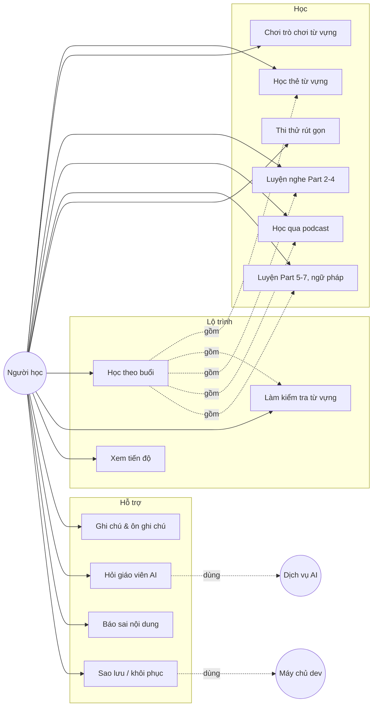
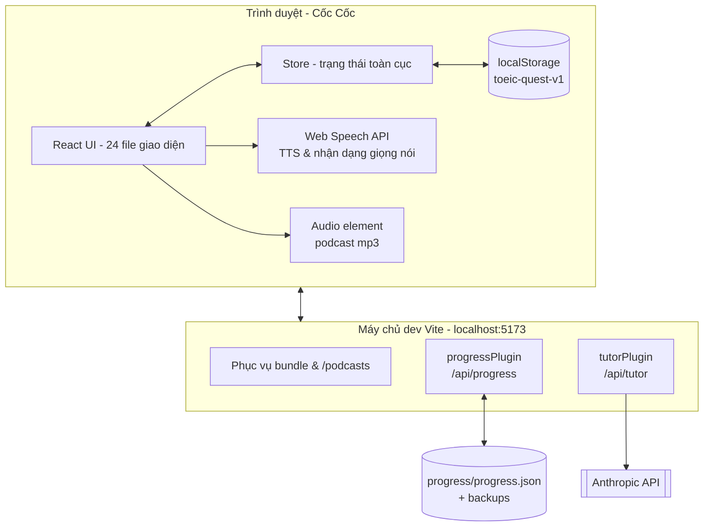
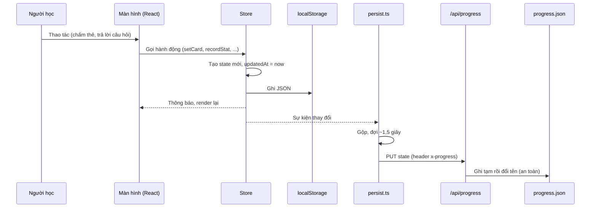
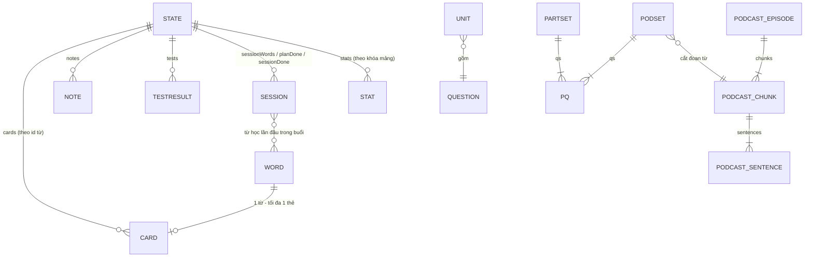
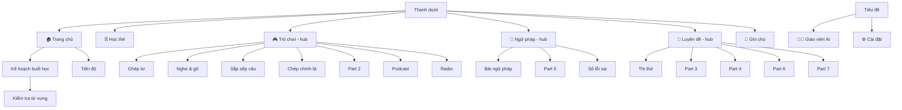
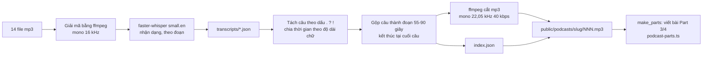

# TÀI LIỆU PHÂN TÍCH & THIẾT KẾ HỆ THỐNG

**Hệ thống:** TOEIC Quest, web học TOEIC cá nhân (0 → 600 điểm)
**Phiên bản tài liệu:** 1.0
**Ngày lập:** 21/11/2026
**Phạm vi:** toàn bộ chức năng hiện có của web tại thời điểm lập tài liệu

> Tài liệu mô tả hệ thống **như đã được xây dựng trong mã nguồn**. Những phần chưa được kiểm thử trên trình duyệt thật được ghi rõ ở mục 13.

---

## MỤC LỤC

1. Giới thiệu
2. Khảo sát và phân tích yêu cầu
3. Mô hình use case
4. Kiến trúc hệ thống
5. Thiết kế dữ liệu
6. Thiết kế chi tiết các phân hệ
7. Thiết kế giao diện và điều hướng
8. Thiết kế API
9. Bảo mật, quyền riêng tư và bản quyền
10. Triển khai và vận hành
11. Quy trình xử lý dữ liệu âm thanh (podcast)
12. Số liệu nội dung
13. Kiểm thử, hạn chế và hướng phát triển
14. Phụ lục

---

## 1. GIỚI THIỆU

### 1.1 Mục đích
Xây dựng một website học TOEIC **dùng riêng cho một người học** (không thương mại) với lộ trình từ 0 đến 600 điểm trong khoảng **20/11/2026 → 25/02/2027 (96 buổi, khoảng 14 tuần)**. Hệ thống kết hợp học có kế hoạch với **trò chơi hóa** (XP, cấp độ, streak, huy hiệu) để "vừa chơi vừa học, nhớ lâu".

### 1.2 Phạm vi
| Trong phạm vi | Ngoài phạm vi |
|---|---|
| Học từ vựng bằng thẻ lặp lại ngắt quãng (SRS) | Tài khoản đa người dùng, đăng nhập |
| Trò chơi từ vựng, luyện nghe, luyện đọc, thi thử rút gọn | Đồng bộ dữ liệu giữa nhiều thiết bị |
| Luyện nghe từ podcast cá nhân | Cung cấp sẵn ảnh Part 1 (người học tự thêm ảnh, xem `docs/PART1_HUONG_DAN.md`) |
| Ghi chú cá nhân có ôn tập (cloze) | Chấm điểm thi thật, quy đổi điểm chính thức |
| Kế hoạch theo buổi học có điều kiện điểm tối thiểu | Phát hành công khai / thương mại |
| Giáo viên AI (tùy chọn, cần khóa API) | |
| Lưu tiến độ trong trình duyệt và ra file | |

### 1.3 Thuật ngữ
| Thuật ngữ | Nghĩa |
|---|---|
| SRS | Spaced Repetition System, lặp lại ngắt quãng |
| Buổi học | Một đơn vị lộ trình gồm nhiều mục; buổi sau chỉ mở khi buổi trước hoàn thành |
| Gate | Điều kiện điểm tối thiểu (70%) của một mục trong buổi |
| Cloze | Câu/ghi chú bị che từ khóa để người học tự điền |
| Chunk (đoạn) | Một đoạn podcast cắt khoảng 1 phút |
| Part 1–7 | Các phần của đề TOEIC (Nghe: 1–4, Đọc: 5–7) |

### 1.4 Tài liệu liên quan
- `KE_HOACH.md`: kế hoạch ban đầu, lộ trình 14 tuần.
- `.env.example`: biến môi trường cho giáo viên AI.

---

## 2. KHẢO SÁT VÀ PHÂN TÍCH YÊU CẦU

### 2.1 Các bên liên quan
| Bên | Vai trò |
|---|---|
| Người học (chủ hệ thống) | Người dùng duy nhất, đồng thời là người quyết định yêu cầu |
| Máy chủ dev cục bộ | Cung cấp API giáo viên AI và lưu file tiến độ |
| Dịch vụ AI (Anthropic API) | Tùy chọn, trả lời cho mục Giáo viên AI |

### 2.2 Yêu cầu chức năng (FR)

**A. Học từ vựng**
| Mã | Yêu cầu |
|---|---|
| FR-A1 | Học từ bằng thẻ lật: từ, phiên âm, loại từ, nghĩa, ví dụ và nghĩa ví dụ; phát âm bằng giọng đọc |
| FR-A2 | Chấm mức nhớ 4 bậc (Quên / Khó / Nhớ / Dễ) và tự xếp lịch ôn theo SRS |
| FR-A3 | Giới hạn số từ mới mỗi ngày và mục tiêu thẻ mỗi ngày (cấu hình được) |
| FR-A4 | Kho từ 1.395 từ, mỗi từ có phiên âm, nghĩa tiếng Việt và câu ví dụ |
| FR-A5 | Kiểm tra từ vừa học và ôn lại từ của các buổi trước, nhiều hình thức (xem 6.8) |

**B. Trò chơi từ vựng**
| Mã | Yêu cầu |
|---|---|
| FR-B1 | Ghép từ – nghĩa trong 60 giây, có combo, ghép sai bị trừ điểm |
| FR-B2 | Nghe & gõ trong 60 giây |
| FR-B3 | Sắp xếp câu (8 câu mỗi ván) |
| FR-B4 | Radio: phát từ vựng liên tục để nghe thụ động |
| FR-B5 | Lưu kỷ lục từng trò chơi |

**C. Luyện nghe**
| Mã | Yêu cầu |
|---|---|
| FR-C1 | Chép chính tả (6 câu mỗi lượt), tô chỗ sai |
| FR-C2 | Part 2 Hỏi–Đáp (8 câu mỗi lượt), lựa chọn bị ẩn cho tới khi nộp |
| FR-C3 | Part 3, 4: nghe rồi trả lời câu hỏi, xem lời thoại sau khi nộp |
| FR-C4 | Podcast cá nhân: nghe, điền từ, chép, nhại (shadowing), học từ vựng trong đoạn |
| FR-C5 | Bài Part 3/4 bổ trợ lấy từ podcast, phát bằng giọng thật |
| FR-C6 | Part 1 Tranh ảnh: hiển thị ảnh do người học thêm, đọc 4 câu mô tả A–D, chọn câu đúng nhất; khung sẵn sàng, chưa kèm ảnh |

**D. Luyện đọc và ngữ pháp**
| Mã | Yêu cầu |
|---|---|
| FR-D1 | 9 bài ngữ pháp có quy tắc, ví dụ, mẹo làm bài |
| FR-D2 | Part 5: 176 câu, theo chủ đề, 5 tim, 10 câu mỗi lượt, giải thích ngay |
| FR-D3 | Part 6, 7: các bài đọc có câu hỏi, hiển thị theo bố cục tài liệu (email, thư, thông báo, tin nhắn, lịch, bảng, hóa đơn, biểu mẫu) |
| FR-D6 | Part 3, 4: một số bài có hình kèm theo (bảng, biểu đồ cột, sơ đồ mặt bằng) và câu hỏi dạng “Look at the graphic.” |
| FR-D4 | Sổ lỗi sai: câu sai phải đúng 2 lần liên tiếp mới được xóa |
| FR-D5 | Thi thử rút gọn (35 phút, khoảng 35–37 câu) và điểm quy đổi ước tính |

**E. Lộ trình và điều kiện hoàn thành**
| Mã | Yêu cầu |
|---|---|
| FR-E1 | Lộ trình 14 tuần chia 4 giai đoạn, kế hoạch **theo buổi học** (không theo ngày thực) |
| FR-E2 | Hai chế độ thời lượng: "Chỉ học" (60 phút cơ bản) và "Có game" (90 phút cơ bản) |
| FR-E3 | Từ buổi 2 có thêm bước ôn kiểm tra các buổi trước (10 → 15 phút tùy buổi) |
| FR-E4 | Điểm tối thiểu **70%** cho các mục kiểm tra, nghe, đọc; buổi sau chỉ mở khi buổi trước hoàn thành |
| FR-E5 | So tiến độ với lịch (đi trước / đúng / chậm) |
| FR-E6 | Thưởng 30 XP khi hoàn thành một buổi |

**F. Gamification và theo dõi**
| Mã | Yêu cầu |
|---|---|
| FR-F1 | XP, cấp độ, danh hiệu, streak ngày liên tiếp |
| FR-F2 | 17 huy hiệu thành tích |
| FR-F3 | Màn Tiến độ: từ đã học, điểm yếu, độ chính xác theo mảng, lịch sử thi thử, nơi học tiếp |
| FR-F4 | Biểu đồ XP và số thẻ 14 ngày gần nhất |

**G. Ghi chú và hỗ trợ học**
| Mã | Yêu cầu |
|---|---|
| FR-G1 | Ghi chú cá nhân (markdown nhỏ), thẻ gắn nhãn, tìm kiếm |
| FR-G2 | Đặt từ khóa trong `[[...]]` để ẩn khi ôn; ôn ghi chú theo SRS |
| FR-G3 | Tạo ghi chú nháp từ câu hỏi, từ vựng, câu podcast; sao chép câu lệnh sẵn cho AI bên ngoài |
| FR-G4 | Nút "Báo sai" trên từ, câu hỏi, câu podcast; gom danh sách để sửa |

**H. Giáo viên AI (tùy chọn)**
| Mã | Yêu cầu |
|---|---|
| FR-H1 | Chế độ trò chuyện, giải thích câu sai, giải thích từ, nhận xét tuần |
| FR-H2 | Nhập vai nói theo 7 tình huống công sở, dùng nhận dạng giọng nói của trình duyệt |
| FR-H3 | Hoạt động khi có khóa API trong `.env`; không có khóa thì tính năng báo chưa cấu hình |

**I. Dữ liệu và vận hành**
| Mã | Yêu cầu |
|---|---|
| FR-I1 | Tự lưu tiến độ trong trình duyệt (localStorage) sau mỗi thao tác |
| FR-I2 | Tự lưu ra file `progress/progress.json`, tự nạp lại khi trình duyệt trống |
| FR-I3 | Sao lưu dự phòng hằng ngày và khi dữ liệu bị giảm mạnh |
| FR-I4 | Xuất / nhập file JSON thủ công; xóa toàn bộ tiến độ |
| FR-I5 | Khởi chạy một cú nhấp (start.bat, lối tắt Desktop, mở bằng Cốc Cốc) |

### 2.3 Yêu cầu phi chức năng (NFR)
| Mã | Yêu cầu | Cách đáp ứng |
|---|---|---|
| NFR-1 | Giao diện tiếng Việt, dùng được trên điện thoại | Tailwind, bố cục một cột, thanh điều hướng dưới |
| NFR-2 | Không cần máy chủ ngoài để học | Toàn bộ nội dung nằm trong bundle; tiến độ lưu cục bộ |
| NFR-3 | Riêng tư | Dữ liệu ở máy người học; khóa API chỉ ở máy chủ dev; API chỉ nhận yêu cầu cục bộ |
| NFR-4 | Bền dữ liệu | Hai lớp lưu (localStorage + file) và sao lưu dự phòng |
| NFR-5 | Khởi động nhanh, không cần cơ sở dữ liệu | Vite dev server, trạng thái trong bộ nhớ |
| NFR-6 | Bản quyền | Nội dung tự viết; audio podcast không đưa lên mạng |
| NFR-7 | Dễ mở rộng nội dung | Dữ liệu tách thành các file `src/data/*` |

### 2.4 Ràng buộc và giả định
- Chỉ **một người dùng**, một trình duyệt chính (Cốc Cốc) và một địa chỉ `localhost:5173`.
- Giọng đọc và nhận dạng giọng nói dùng API của trình duyệt (khuyến nghị Chrome / Edge / Cốc Cốc); chất lượng phụ thuộc giọng hệ thống.
- Nội dung câu hỏi và từ vựng do tác giả hệ thống tự viết, **không chép từ đề hay từ điển có bản quyền**; có thể còn sai sót, vì vậy có nút Báo sai.
- Lời chép podcast do máy nhận dạng, có thể sai vài chữ.

---

## 3. MÔ HÌNH USE CASE

### 3.1 Tác nhân
| Tác nhân | Mô tả |
|---|---|
| Người học | Dùng toàn bộ chức năng học |
| Máy chủ dev | Tác nhân hệ thống: ghi/đọc file tiến độ, gọi API AI |
| Dịch vụ AI | Tác nhân ngoài, tùy chọn |
| Trình duyệt | Cung cấp lưu trữ, TTS, nhận dạng giọng nói |

### 3.2 Sơ đồ use case tổng quát


### 3.3 Danh sách use case
| Mã | Use case | Mô tả ngắn |
|---|---|---|
| UC01 | Học thẻ từ vựng | Ôn thẻ đến hạn, học từ mới, chấm 4 bậc |
| UC02 | Chơi Ghép từ / Nghe & gõ / Sắp xếp câu | Trò chơi tính giờ, lưu kỷ lục, cộng XP |
| UC03 | Luyện Part 2 / 3 / 4 | Nghe, chọn đáp án, xem giải thích |
| UC04 | Chép chính tả | Nghe câu, gõ lại, so chữ |
| UC05 | Học qua podcast | Nghe, điền từ, chép, nhại, học từ |
| UC06 | Luyện Part 5 | Theo chủ đề, tim, giải thích, sổ lỗi sai |
| UC07 | Luyện Part 6 / 7 | Đọc đoạn, trả lời |
| UC08 | Thi thử rút gọn | 35 phút, chấm điểm ước tính |
| UC09 | Học theo buổi | Làm lần lượt các mục; qua buổi khi đạt điều kiện |
| UC10 | Kiểm tra từ vừa học | 6 từ × 4 câu |
| UC11 | Ôn kiểm tra các buổi trước | Từ ngẫu nhiên từ mọi buổi trước, nhiều hình thức |
| UC12 | Quản lý ghi chú | Tạo, sửa, xóa, tìm, ôn |
| UC13 | Hỏi giáo viên AI / Nhập vai nói | Cần khóa API |
| UC14 | Xem tiến độ | Từ đã học, điểm yếu, nơi học tiếp |
| UC15 | Báo sai | Gom danh sách mục nghi sai |
| UC16 | Sao lưu / khôi phục | Xuất, nhập, tự lưu file |

### 3.4 Đặc tả use case chính

**UC09. Học theo buổi**
| Mục | Nội dung |
|---|---|
| Tác nhân | Người học |
| Tiền điều kiện | Buổi hiện tại chưa hoàn thành |
| Luồng chính | 1) Người học mở Kế hoạch. 2) Hệ thống hiển thị các mục của buổi `n` với số phút. 3) Người học bấm "Bắt đầu" để vào màn tương ứng. 4) Khi làm xong, mục có gate tự được đánh dấu nếu đạt 70%; mục không gate người học tự tick. 5) Khi mọi mục xong, hệ thống đánh dấu buổi hoàn thành, thưởng 30 XP và hiện nút "Sang buổi n+1". |
| Luồng thay thế | Chưa đạt 70%: mục vẫn khóa, người học làm lượt khác. Chưa đủ từ ở bước ôn buổi trước: được "Bỏ qua bước này". |
| Hậu điều kiện | `sessionDone[n]` có thời điểm; `sessionNo` tăng 1 khi người học bấm sang buổi sau |
| Quy tắc | Buổi sau chỉ mở khi buổi trước hoàn thành; không phụ thuộc ngày thực |

**UC10/UC11. Kiểm tra từ vựng**
| Mục | Nội dung |
|---|---|
| Luồng chính | 1) Hệ thống chọn từ (từ buổi hiện tại hoặc từ các buổi trước). 2) Sinh câu hỏi theo từng hình thức. 3) Người học trả lời; hệ thống giải thích **mọi đáp án**. 4) Kết thúc: tính điểm, từ sai về hàng ôn thẻ, ghi điểm tốt nhất. 5) Đạt từ 70% thì đánh dấu mục xong. |
| Ngoại lệ | Dưới 3 từ khả dụng: báo chưa đủ từ (ôn buổi trước có nút bỏ qua) |

**UC01. Học thẻ**
| Mục | Nội dung |
|---|---|
| Luồng chính | Chụp danh sách (thẻ đến hạn + từ mới còn trong hạn mức ngày) → hiện thẻ → người học lật → chấm 0–3 → cập nhật lịch ôn, cộng XP |
| Quy tắc | Quên (0): ôn lại sau 1 phút; Khó/Nhớ/Dễ: tăng khoảng cách theo công thức ở mục 6.1 |

---

## 4. KIẾN TRÚC HỆ THỐNG

### 4.1 Tổng quan
Hệ thống là **ứng dụng một trang (SPA)** chạy trên trình duyệt, kèm một **máy chủ phát triển Vite** mở rộng bằng hai plugin API. Không có cơ sở dữ liệu: trạng thái nằm trong bộ nhớ, được ghi vào localStorage và ra file.



### 4.2 Công nghệ
| Lớp | Công nghệ |
|---|---|
| Giao diện | React 19, TypeScript, Tailwind CSS 4 |
| Build & server | Vite 8 (plugin React, Tailwind, hai plugin tự viết) |
| Trạng thái | `useSyncExternalStore` với store tự viết |
| Lưu trữ | localStorage (khóa `toeic-quest-v1`) và file JSON |
| Âm thanh | Web Speech API (TTS, nhận dạng giọng nói), Web Audio (hiệu ứng), thẻ `<audio>` |
| AI | `@anthropic-ai/sdk`, mô hình mặc định `claude-haiku-5-5` |
| Xử lý audio (offline) | faster-whisper (`small.en`), ffmpeg, Python |
| Ngôn ngữ | TypeScript (UI, server plugin), Python (xử lý podcast, chạy ngoài dự án) |

### 4.3 Cấu trúc thư mục
```
web_hoc_TOEIC/
├─ index.html, vite.config.ts, tsconfig.json, package.json
├─ start.bat                 # khởi chạy một cú nhấp
├─ .env(.example)            # khóa API (không đưa lên git)
├─ KE_HOACH.md, docs/        # tài liệu
├─ server/
│  ├─ tutorPlugin.ts         # API giáo viên AI
│  ├─ prompts.ts             # lời nhắc hệ thống cho từng chế độ
│  └─ progressPlugin.ts      # API lưu/đọc tiến độ
├─ src/
│  ├─ main.tsx, App.tsx      # khởi động, điều hướng
│  ├─ lib/                   # logic: store, srs, plan, units, podcast, audio, ...
│  ├─ data/                  # nội dung: từ vựng, câu hỏi, bài nghe, bài đọc, podcast
│  └─ screens/               # các màn hình
├─ public/podcasts/          # audio đã cắt + index.json (không đưa lên mạng)
└─ progress/                 # progress.json + backups (không đưa lên git)
```

### 4.4 Các module và trách nhiệm
| Module | Trách nhiệm |
|---|---|
| `lib/store.ts` | Trạng thái toàn cục, các hành động ghi, lưu localStorage, XP/cấp độ, buổi học, điểm kiểm tra |
| `lib/srs.ts` | Thuật toán SRS, chọn thẻ đến hạn / từ mới |
| `lib/plan.ts` | Định nghĩa các mục, bảng kế hoạch theo giai đoạn, gate, đánh giá điểm |
| `lib/sessionGate.ts` | Hook tự đánh dấu mục có gate khi đạt điểm |
| `lib/units.ts` | Chuẩn hóa mọi bài nghe/đọc thành `Unit`, dựng bài luyện và thi thử, ghi thống kê |
| `lib/persist.ts` | Đồng bộ với file tiến độ |
| `lib/podcast.ts` | Đọc chỉ mục podcast, phát một đoạn thời gian |
| `lib/audio.ts` | TTS, chọn giọng, hiệu ứng âm thanh |
| `lib/diff.ts` | So khớp câu chép với đáp án (LCS) |
| `lib/roadmap.ts` | Ngày bắt đầu / thi, giai đoạn, mục tiêu từ, huy hiệu |
| `lib/tutor.ts`, `lib/askPrompt.ts`, `lib/notesBus.ts` | Gọi giáo viên AI, tạo câu lệnh cho AI ngoài, chuyển bản nháp ghi chú |
| `screens/*` | 24 file giao diện (màn hình và thành phần) (xem mục 7) |

### 4.5 Luồng dữ liệu chính


**Khởi động ứng dụng:** `main.tsx` gọi `initPersist()` **trước khi hiển thị**. Nếu file trên đĩa có `updatedAt` lớn hơn trong trình duyệt thì nạp từ file; nếu không có máy chủ (bản tĩnh) thì tính năng tự tắt.

---

## 5. THIẾT KẾ DỮ LIỆU

Hệ thống không dùng cơ sở dữ liệu quan hệ. Có **ba nhóm dữ liệu**: (1) nội dung tĩnh trong mã nguồn, (2) tiến độ người học (một đối tượng JSON), (3) dữ liệu podcast (file ngoài).

### 5.1 Sơ đồ quan hệ khái niệm


### 5.2 Trạng thái người học (`State`)
Lưu trong localStorage khóa `toeic-quest-v1` và file `progress/progress.json`.

| Trường | Kiểu | Ý nghĩa |
|---|---|---|
| `cards` | `Record<id từ, Card>` | Thẻ SRS của từng từ |
| `xp`, `streak`, `bestStreak`, `lastDay` | số / chuỗi | Điểm kinh nghiệm, chuỗi ngày học |
| `daily` | `{date, reviewed, xp, newLearned}` | Số liệu của ngày hiện tại |
| `dayLog` | `Record<ngày, {xp, reviewed}>` | Lịch sử các ngày trước (giữ 120 ngày) |
| `best` | `{match, typing, combo, order}` | Kỷ lục trò chơi |
| `settings` | `{newPerDay, dailyGoal, planMin}` | Cấu hình: từ mới/ngày, mục tiêu thẻ, chế độ 60/90 phút |
| `startedAt` | chuỗi ngày | Ngày bắt đầu |
| `mistakes` | `Record<id câu, {wrong, streak}>` | Sổ lỗi sai |
| `stats` | `Record<khóa, {ok, total}>` | Thống kê đúng/sai theo mảng (xem phụ lục 14.3) |
| `fixed` | số | Số câu đã xóa khỏi sổ lỗi sai |
| `lessons` | `string[]` | Bài ngữ pháp đã học |
| `flags` | `Record<khóa, true>` | Mục báo sai (`w:`, `q:`, `l:`, `p:`) |
| `tests` | `TestResult[]` | Lịch sử thi thử (giữ 50 lần) |
| `notes` | `Note[]` | Ghi chú cá nhân |
| `podcastDone` | `Record<id đoạn, true>` | Đoạn podcast đã hoàn thành |
| `planDone` | `Record<'s{n}', string[]>` | Các mục đã xong của buổi `n`; `_bonus` = đã nhận thưởng |
| `sessionNo` | số | Buổi học hiện tại |
| `sessionWords` | `Record<số buổi, id từ[]>` | Từ học lần đầu trong từng buổi |
| `sessionDone` | `Record<số buổi, epoch ms>` | Thời điểm hoàn thành buổi |
| `checkBest` | `Record<'s{n}:{mục}', 0–1>` | Điểm tốt nhất của bước kiểm tra |
| `sessionAnswers` | `Record<số buổi, Record<khóa, boolean[]>>` | 40 kết quả gần nhất của Part 2–7, chép, podcast trong buổi |
| `updatedAt` | epoch ms | Thời điểm thay đổi cuối; 0 = chưa thao tác. Dùng để đồng bộ file |

**`Card`:** `{ease, interval (ngày), due (epoch ms), reps, lapses, at?}`; `at` là thời điểm học lần đầu.
**`Note`:** `{id, title, body, tags[], createdAt, updatedAt, srs: Card}`.
**`TestResult`:** `{date, correct, total, listening{ok,total}, reading{ok,total}, score, seconds}`.

### 5.3 Dữ liệu nội dung tĩnh (`src/data`)
| Cấu trúc | Trường chính | Số lượng |
|---|---|---|
| `Word` | `id, en, ipa, pos, vi, ex, exVi` | 1.395 từ (gộp từ 8 file, loại trùng theo id) |
| `Question` (Part 5) | `id, q, opts[4], a, why, tag` | 176 câu; 9 chủ đề |
| `P2` (Part 2) | `id, q, viQ, r[3], viA, why` | 40 câu |
| `PartSet` (Part 3/4/6/7) | `id, kind, title, lines/text, vi, graphic?, qs[]` | P3: 16, P4: 14, P6: 7, P7: 21 bài (gồm 10 bài Part 3/4 có hình, 3 bài Part 7 dạng bảng) |
| `Lesson` | `id(Tag), title, tip, points[], examples[]` | 9 bài |
| `PodSet` | `id, kind, title, file, start, end, lines[], vi, qs[]` | 48 bài (35 Part 4, 13 Part 3) |
| Huy hiệu | `id, icon, name, desc, check(state)` | 17 |

**Chuẩn hóa thành `Unit`** (trong `units.ts`) để mọi bài dùng chung một màn hình làm bài:
`Unit = {id, part, title, audio?[], clip?{src,start,end}, hideOpts?, passage?, transcript?[], vi?, qs: UQ[]}`
`UQ = {id, q, opts[], a, why, stat, tag?}`
Trường `stat` là khóa thống kê và quyết định câu được tính vào mảng nào.

### 5.4 Dữ liệu podcast
`public/podcasts/index.json`:
```
{ episodes: [ { id, title, level, duration,
   chunks: [ { id, file, dur, sentences: [ { s, e, t } ] } ] } ] }
```
`s`, `e` tính theo giây từ đầu đoạn. Hiện có 14 tập, 453 đoạn, khoảng 132 MB, 6.576 câu.

### 5.5 File tiến độ
`progress/progress.json` là bản sao của `State`. Thư mục `progress/backups/` chứa:
- `progress-YYYY-MM-DD.json`: bản đầu tiên mỗi ngày, giữ 14 bản gần nhất.
- `before-drop-<thời điểm>.json`: bản trước khi bị ghi đè bằng dữ liệu có XP nhỏ hơn một nửa (ví dụ xóa toàn bộ).

### 5.6 Quy tắc toàn vẹn
- Mỗi từ tối đa một thẻ; id từ là khóa duy nhất.
- `updatedAt` chỉ tăng khi có thao tác; trạng thái mới nguyên (0) **không bao giờ** được ghi đè lên file có dữ liệu.
- Máy chủ từ chối ghi nếu `updatedAt` cũ hơn bản trên đĩa (mã 409).
- `togglePlanTask` với `force` chỉ đánh dấu xong, không bỏ đánh dấu.

---

## 6. THIẾT KẾ CHI TIẾT CÁC PHÂN HỆ

### 6.1 Học từ vựng bằng SRS
**Lịch ôn (`schedule`)** theo kiểu SM-2 đơn giản:

| Mức chấm | Tác dụng |
|---|---|
| 0 Quên | `lapses+1`, `reps=0`, `ease -0,2` (tối thiểu 1,3), ôn lại sau **1 phút** |
| 1 Khó | `ease -0,15`, `interval = max(interval,1) × 1,2` |
| 2 Nhớ | `interval` = 1 ngày (lần đầu), 3 ngày (lần hai), sau đó `interval × ease` |
| 3 Dễ | `ease +0,15`; `interval` = 3 ngày (lần đầu), sau đó `interval × ease × 1,3` |

- **XP:** Quên 1, Khó 3, Nhớ 5, Dễ 6; từ mới được thêm 5 khi nhớ được.
- **Chọn thẻ:** `dueWords` (đến hạn, sắp theo thời gian) + `newWords` (chưa có thẻ, theo hạn mức `newPerDay − newLearned`).
- **Từ đã thuộc:** `interval ≥ 21` ngày. **Từ đã học:** `reps > 0`.
- Khi học lần đầu một từ, `setCard` ghi `at` và thêm id vào `sessionWords[sessionNo]`.

### 6.2 Trò chơi từ vựng
| Trò | Cơ chế | Lưu |
|---|---|---|
| Ghép từ – nghĩa | 60 giây; ghép đúng thay cặp mới, combo liên tiếp, ghép sai trừ điểm | kỷ lục `match`, `combo` |
| Nghe & gõ | 60 giây; nghe từ, gõ đúng từ | kỷ lục `typing` |
| Sắp xếp câu | 8 câu; sắp các từ thành câu ví dụ đúng | kỷ lục `order` |
| Radio | Đọc lần lượt từ, nghĩa tiếng Việt và câu ví dụ (hai phần sau bật/tắt được), tốc độ chỉnh được; ưu tiên từ đến hạn, tối đa 40 từ | không tính điểm |

### 6.3 Luyện nghe
- **Chép chính tả (6 câu):** nghe một câu, gõ lại; `diffSentence` so theo từ bằng LCS, tô đúng/sai. Câu đúng khi độ chính xác ≥ **90%**; ghi `l-dict`.
- **Part 2 (8 câu):** đọc câu hỏi và 3 lời đáp bằng hai giọng khác nhau, lời đáp bị ẩn đến khi nộp; ghi `l-p2`.
- **Part 3, 4:** phát lời thoại hoặc bài nói; 10 bài có **hình** (`Graphic`: bảng, biểu đồ cột có nút xem số liệu, sơ đồ mặt bằng dạng lưới) hiển thị trong lúc nghe, với câu hỏi “Look at the graphic.” (dữ liệu trong `data/parts-graphic.ts`); có thể nghe lại; sau khi nộp hiện lời chép, giải thích và tóm tắt tiếng Việt; ghi `l-p3`, `l-p4`.
- **Part 1 (Tranh ảnh):** ảnh và câu mô tả do người học tự thêm vào `public/photos/` cùng file `part1.json` (`id, file, title, options[4], answer, why, vi?`). Web hiển thị ảnh, đọc 4 câu A–D bằng giọng máy (nội dung bị ẩn đến khi nộp), xáo thứ tự đáp án mỗi lần; ghi `l-p1`. Loader (`lib/part1.ts`) kiểm tra từng mục, chỉ nhận tên file ảnh trong thư mục (chặn đường dẫn và địa chỉ ngoài). Từ 6 ảnh, Part 1 được chèn vào kế hoạch các giai đoạn đầu (8 phút, trước Part 2, gate 6 ảnh đúng ≥ 70%) và thi thử thêm 2 câu Part 1; chưa đủ ảnh thì mục này tự ẩn.
- **Thi thử:** mỗi đoạn nghe được phát một lần và nghe lại một lần.
- Giọng đọc: chọn giọng tiếng Anh của hệ thống; giọng thứ hai cho người nói B/lời đáp.

### 6.4 Podcast cá nhân
**Nguồn:** 14 file mp3 do người học cung cấp, đã cắt thành 453 đoạn khoảng 1 phút (xem mục 11).

**Màn hình:** danh sách tập → lưới đoạn → màn đoạn có **5 chế độ**:
| Chế độ | Hoạt động | Tính điểm |
|---|---|---|
| 🎧 Nghe | Trình phát tự viết: tốc độ 0,75–1,15, tua ±5 giây, ẩn/hiện lời chép; bấm câu để phát riêng câu; từ có trong kho từ được gạch chấm; ghi chú nháp; Báo sai | Không |
| 🧩 Điền từ | Nghe một câu; câu hiện với **một từ nội dung bị ẩn** (ưu tiên từ có trong kho); gõ lại | Có (`l-pod`) |
| ✍️ Chép | Chép cả câu, tô chỗ sai | Có (`l-pod`, đúng khi ≥ 85%) |
| 🗣️ Nhại | Phát câu, im lặng bằng độ dài câu rồi lặp lại 3 lần | Không |
| 📚 Học | Liệt kê từ trong kho xuất hiện trong đoạn (nghe, nghĩa, ví dụ, nút "+ Ôn"); sao chép câu lệnh dịch/rút từ cho AI ngoài; tạo ghi chú | Không |

- Hoàn thành một đoạn: `+8 XP` và ghi `podcastDone`.
- `playRange` phát một khoảng thời gian; dùng token để hủy lượt phát cũ, chỉ lượt mới nhất được phép dừng audio.

**Bài Part 3/4 từ podcast (`PodSet`):** 48 bài (35 P4, 13 P3, 159 câu hỏi) gắn với `file`, `start`, `end`. Trong luyện Part 3/4, podcast chiếm **tối đa 1/3** số bài mỗi lượt; trong thi thử chỉ có khi người học tick tùy chọn (thay một trong hai bài). Các bài chỉ xuất hiện nếu `index.json` đã tải được.

### 6.5 Ngữ pháp và Part 5
- **Bài ngữ pháp:** quy tắc, mẹo, ví dụ có dịch; đánh dấu đã học (+10 XP).
- **Part 5:** chọn theo chủ đề (dạng từ, thì, giới từ, liên từ, đại từ, bị động, điều kiện, so sánh, từ vựng) hoặc trộn; một lượt 10 câu, **5 tim** (sai mất 1 tim, hết tim thì kết thúc); giải thích ngay sau mỗi câu.
- **Sổ lỗi sai:** câu sai được ghi vào `mistakes`; trả lời đúng **2 lần liên tiếp** thì xóa (tăng `fixed`). Có chế độ ôn riêng sổ lỗi sai.
- Thống kê theo chủ đề (`stats[tag]`).

### 6.6 Part 6, 7 và thi thử
- **Part 6:** đoạn có chỗ trống `[1] [2] [3]`; **Part 7:** đoạn đọc kèm câu hỏi. Dựng bằng `unitFromSet`.
- **Bố cục tài liệu (`DocView`):** tự nhận dạng từ văn bản thuần, không phải sửa dữ liệu: dòng `— Tên —` tách nhiều tài liệu; `To/From/Subject/Date` thành phần đầu email; `Tên (9:05 a.m.): …` thành bong bóng tin nhắn; dòng bắt đầu bằng giờ thành bảng lịch; hai dòng `Nhãn: giá trị` liền nhau thành bảng chi tiết; dòng bắt đầu bằng `|` thành bảng (dòng đầu là tiêu đề cột); thư bắt đầu bằng “Dear” được hiển thị như email; nhóm dòng ngắn đầu tiên làm tiêu đề. Chỗ trống `[n]` của Part 6 được tô nổi trong mọi bố cục. Có 3 bài Part 7 mới (`data/parts-docs.ts`): hóa đơn, lịch xe đưa đón, biểu mẫu đăng ký.
- **Thi thử rút gọn:** 6 câu Part 2, 2 bài Part 3, 2 bài Part 4, 8 câu Part 5, 1 bài Part 6, 2 bài Part 7 (khoảng 35–37 câu); **35 phút**, đồng hồ chạy suốt; nộp xong mới có đáp án.
- **Điểm quy đổi:** `estimateScaled(p) = clamp(round((5 + 490p)/5) × 5, 5, 495)` cho Nghe và Đọc; tổng hai phần. Đây là **ước tính rất thô** (đề ngắn, tự viết, giọng máy), chỉ dùng xem xu hướng.
- Kết quả lưu vào `tests`, phân tích theo Part, danh sách câu sai kèm giải thích và nút hỏi AI.

### 6.7 Kế hoạch theo buổi học và điều kiện hoàn thành
**Khái niệm:** lộ trình gồm các **buổi** `n = 1, 2, 3…`. Buổi `n` thuộc **tuần** `⌊(n−1)/7⌋+1` (tối đa 14) và dùng mẫu của thứ `ORDER[(n−1) mod 7]` trong tuần học đó.

**Giai đoạn:**
| Giai đoạn | Tuần | Trọng tâm | Mục tiêu điểm |
|---|---|---|---|
| Nền tảng | 1–4 | 600 từ cốt lõi, ngữ pháp cơ bản, nghe Part 1–2 | 250–300 |
| Xây dựng | 5–9 | +600 từ công sở, Part 3–4, Part 5–6 | 400–450 |
| Tăng tốc | 10–13 | Luyện đề theo Part, phân tích câu sai | 500–550 |
| Về đích | 14 | Thi thử full, ôn sổ lỗi sai | 600+ |

**Hai chế độ:** "Chỉ học" (60 phút cơ bản, không game) và "Có game" (90 phút cơ bản). Mỗi buổi gồm 4–5 mục cơ bản, **cộng**:
- Bước **✅ Kiểm tra từ vừa học** (8 phút), có trong mọi buổi có học thẻ.
- Từ buổi 2: bước **🔁 Kiểm tra lại các buổi trước**: 10 phút (buổi 2–3), 12 phút (buổi 4–7), 15 phút (từ buổi 8).

**Các mục (`Key`):** `cards`, `vcheck`, `rcheck`, `games`, `order`, `dict`, `p2`, `p3`, `p4`, `p5`, `p6`, `p7`, `lesson`, `podcast`, `review`, `notes`, `mock`. Mỗi mục có biểu tượng, tên, hướng dẫn làm, cách tự kiểm tra, màn hình đích (và tham số), và gate nếu có.

**Gate (điểm tối thiểu 70%):**
| Mục | Khóa thống kê | Số câu tối thiểu | Điều kiện đạt |
|---|---|---|---|
| Part 1 | `l-p1` | 6 | đúng ≥ 70% trong 6 ảnh gần nhất (chỉ khi có ≥ 6 ảnh) |
| Part 2 | `l-p2` | 10 | đúng ≥ 70% trong 10 câu gần nhất |
| Part 3 | `l-p3` | 6 | đúng ≥ 70% trong 6 câu gần nhất |
| Part 4 | `l-p4` | 6 | như trên |
| Part 5 | `p5` | 10 | đúng ≥ 7/10 trong 10 câu gần nhất |
| Part 6 | `r-p6` | 6 | đúng ≥ 70% trong 6 chỗ trống gần nhất |
| Part 7 | `r-p7` | 6 | đúng ≥ 70% trong 6 câu gần nhất |
| Chép chính tả | `l-dict` | 8 | đúng ≥ 70% (mỗi câu đúng khi ≥ 90% chữ) |
| Podcast | `l-pod` | 8 | đúng ≥ 70% (Điền từ + Chép ≥ 85%) |
| Kiểm tra từ vựng / ôn buổi trước | điểm lượt kiểm tra | cả lượt | điểm lượt ≥ 70% |

- **Số câu tối thiểu tăng theo số phút của mục:** `need = max(số câu gốc, phút × tốc độ)`, tối đa 40. Tốc độ (câu/phút): Part 2 = 1; Part 5 = 0,7; Part 3, 4 và Part 6 = 0,4; Part 7 = 0,3; chép chính tả và podcast = 0,8; Part 1 = 0,75. Ví dụ tuần 13: Part 5 30 phút → 21 câu; Part 7 35 phút → 11 câu. Bảng ở trên là số câu gốc (mức sàn).
- Kết quả từng câu được ghi vào `sessionAnswers[buổi][khóa]` (giữ 40 gần nhất); `gateStatus` xét `need` câu cuối.
- Hook `useSessionGate` (gắn trong `App`) theo dõi `sessionAnswers`; khi một mục đạt thì gọi `togglePlanTask(..., force=true)`.
- Các mục có gate **khóa** (🔒), không tick tay. Các mục còn lại (thẻ từ, game, bài ngữ pháp, ôn ghi chú, sổ lỗi sai, thi thử) tự tick.

**Qua buổi:** khi mọi mục xong, `togglePlanTask` ghi `_bonus` (+30 XP) và `sessionDone[n]`; nút "Sang buổi n+1" gọi `nextSession()`, chỉ chạy nếu `sessionDone[n]` tồn tại.

**So tiến độ:** `expectedSession = ⌊(hôm nay − 20/11/2026)/1 ngày⌋ + 1` (1 buổi mỗi ngày). Hệ thống chỉ **báo** đi trước / đúng / chậm, không khóa theo ngày.

### 6.8 Kiểm tra từ vựng
Có hai chế độ (`mode = 'new' | 'review'`).

**Chọn từ:**
- *Từ vừa học:* các từ trong `sessionWords[sessionNo]`; nếu dưới 3 thì bổ sung từ học gần nhất; lấy tối đa 6 từ.
- *Ôn buổi trước:* gộp từ của **mọi** buổi `< sessionNo`, chọn ngẫu nhiên `min(12, 6 + sessionNo)` từ; nếu chưa đủ thì dùng các từ đã học khác.

**5 hình thức câu hỏi:**
| Hình thức | Cách hỏi | Kiểu trả lời |
|---|---|---|
| Nhớ nghĩa (`mean`) | Hiện từ, chọn nghĩa | 4 lựa chọn |
| Phiên âm (`ipa`) | Nghe từ, chọn phiên âm | 4 lựa chọn |
| Nghe & viết (`spell`) | Nghe từ, gõ lại (có nghe chậm) | Gõ |
| Áp dụng (`use`) | Điền từ vào câu ví dụ bị che | 4 lựa chọn |
| Mặt chữ (`rev`) | Hiện nghĩa tiếng Việt, gõ từ tiếng Anh | Gõ |

- *Từ vừa học:* mỗi từ 4 câu (nghĩa hoặc mặt chữ, phiên âm, nghe & viết, áp dụng). *Ôn buổi trước:* mỗi từ **2 hình thức ngẫu nhiên**, trộn thứ tự câu.
- **Từ gây nhiễu:** ưu tiên cùng loại từ; không trùng đáp án.
- **Giải thích mọi đáp án:** mỗi lựa chọn nêu nó thuộc từ nào, nghĩa/phiên âm/loại từ, và vì sao đúng/sai (ví dụ "khác loại từ so với chỗ trống"). Với câu gõ: hiện mặt chữ đúng, tô chữ cái bạn thiếu/sai (LCS theo ký tự), và nếu bạn gõ trúng một từ khác trong kho thì nêu từ đó.
- **Kết thúc:** tính điểm theo hình thức; các từ sai được `gradeWord(id, 0)` (quay lại hàng ôn); `recordCheckResult` ghi điểm tốt nhất và đánh dấu mục xong nếu ≥ 70%. Nếu chưa đạt: nút "Làm lại lượt khác" dùng bộ câu mới.

### 6.9 Ghi chú
- Soạn ghi chú với markdown rút gọn (tiêu đề `#`, gạch đầu dòng, **đậm**) và nhãn; tìm kiếm.
- Từ khóa trong `[[...]]` được **ẩn khi ôn** (cloze); ôn theo SRS riêng của từng ghi chú (`Note.srs`).
- **Luồng với AI bên ngoài:** nút "Ghi chú" trên câu hỏi, từ, câu podcast tạo bản nháp có sẵn đề; nút "Sao chép câu lệnh" tạo lời nhắc sẵn để dán vào claude.ai; người học dán lại câu trả lời vào ghi chú.

### 6.10 Giáo viên AI (tùy chọn)
| Chế độ | Mô tả |
|---|---|
| `chat` | Trò chuyện, hỏi đáp |
| `roleplay` | Nhập vai nói; 7 tình huống: phỏng vấn, đặt khách sạn, dời lịch họp, đơn hàng trễ, mua vé tàu, khiếu nại, chào đồng nghiệp mới |
| `explain` | Giải thích một câu hỏi và lỗi sai |
| `word` | Giải thích một từ |
| `weekly` | Nhận xét tiến độ tuần |

- Giao diện gọi `/api/tutor` (xem mục 8); máy chủ dựng lời nhắc hệ thống tiếng Việt, ngắn gọn, không bịa đề thi, và coi nội dung "Ngữ cảnh" chỉ là dữ liệu.
- Nói: dùng SpeechRecognition của trình duyệt để lấy chữ, gửi cho AI để nhận xét; phát lại bằng TTS.
- Khi chưa có `ANTHROPIC_API_KEY` thì màn hình báo chưa cấu hình; phần còn lại của web không bị ảnh hưởng.

### 6.11 Tiến độ và gamification
- **XP và cấp:** `level = ⌊√(xp/60)⌋ + 1`; XP cần cho cấp L: `(L−1)² × 60`. Danh hiệu: Newbie (<3), Intern (<5), Office Worker (<8), Team Lead (<12), Manager.
- **Streak:** tăng khi học trong ngày liên tiếp, lưu `bestStreak`.
- **17 huy hiệu:** học 10/50/100 từ, 10 từ đã thuộc, streak 3/7/30 ngày, combo 10, gõ 15 từ/60 giây, cấp 5, 50 câu Part 5 đúng, 20 câu chép ≥ 90%, 20 câu Part 2 đúng, xóa 10 câu sổ lỗi sai, 5 bài ngữ pháp, đúng 8/8 sắp xếp câu, đủ 9 bài ngữ pháp.
- **Trang chủ:** hồ sơ + thanh XP, thẻ buổi học, mục tiêu hôm nay, số từ đến hạn/mới, tiến độ từ so với mục tiêu tuần, biểu đồ 14 ngày, huy hiệu.
- **Màn Tiến độ:** tổng quan, "học tiếp từ đâu", từ đã học (hôm nay / 7 ngày / tất cả) và từ hay quên, độ chính xác theo mảng và cảnh báo điểm yếu (≥ 5 câu và < 70%), podcast và ngữ pháp, lịch sử thi thử.

### 6.12 Lưu trữ và sao lưu
| Lớp | Cơ chế |
|---|---|
| localStorage | Ghi sau **mỗi** thao tác (`commit`) |
| File tiến độ | `persist.ts` gộp thay đổi, ghi sau ~1,5 giây; ghi thêm khi tab ẩn/đóng; trạng thái hiển thị trong Cài đặt |
| Sao lưu thủ công | Xuất/Nhập JSON trong Cài đặt |
| Dự phòng tự động | Bản đầu ngày (14 ngày) và bản trước khi bị giảm mạnh |

**Chính sách đồng bộ khi mở web:** nếu `file.updatedAt > local.updatedAt` thì **nạp từ file**; nếu bằng nhau thì coi đã đồng bộ; nếu local mới hơn thì ghi lại file. Bản tĩnh (không có máy chủ) thì tắt tính năng này.

### 6.13 Báo sai nội dung
Nút "Báo sai" trên từ, câu Part 5, câu Part 2 và câu podcast ghi `flags` (`w:`, `q:`, `l:`, `p:`). Cài đặt liệt kê mô tả từng mục và cho **sao chép danh sách** để gửi sửa.

---

## 7. THIẾT KẾ GIAO DIỆN VÀ ĐIỀU HƯỚNG

### 7.1 Điều hướng
Điều hướng bằng **`Tab`** trong `App.tsx` (không dùng router). Mỗi tab thuộc một **nhóm**; thanh dưới có 6 nhóm; nút "Quay lại" đưa về trung tâm nhóm.



### 7.2 Danh sách màn hình
| Màn hình | Tab | Chức năng chính |
|---|---|---|
| Home | `home` | Hồ sơ, thẻ buổi học, mục tiêu ngày, biểu đồ, huy hiệu |
| Plan | `plan` | Các mục của buổi, số phút, gate, preview 7 buổi, đổi 60/90, sang buổi sau |
| Progress | `progress` | Báo cáo học tập |
| Flashcards | `learn` | Học thẻ SRS |
| Check | `check` | Kiểm tra từ vừa học / ôn các buổi trước |
| GamesHub / Match / Typing / Order | `games`, `match`, `typing`, `order` | Trò chơi |
| Dictation | `dictation` | Chép chính tả |
| Listening | `listen` | Part 2 |
| Podcast | `podcast` | 5 chế độ học podcast |
| Radio | `radio` | Nghe thụ động |
| GrammarHub / Lessons / Quiz | `grammar`, `lessons`, `quiz`, `review` | Ngữ pháp, Part 5, sổ lỗi sai |
| LabHub / Practice / Mock | `lab`, `practice`, `mock` | Luyện Part 3, 4, 6, 7 và thi thử |
| UnitView | (dùng chung) | Màn làm bài chung cho Part 2–7 |
| Notes | `notes` | Ghi chú và ôn ghi chú |
| Teacher | `teacher` | Giáo viên AI |
| Settings | `settings` | Mục tiêu, sao lưu, tự lưu file, báo sai, xóa |
| ProgressChart, AskButton, FlagButton | (thành phần) | Biểu đồ, nút hỏi AI/ghi chú, báo sai |

### 7.3 Giao diện Dark Competitive (đã áp dụng)
- **Khung ứng dụng desktop:** sidebar trái (6 nhóm, có thể thu gọn, có thẻ cấp độ), topbar (tên màn hình, nút quay lại, XP/cấp, streak, Giáo viên AI, Cài đặt), nội dung rộng tối đa 6xl cho màn tổng hợp và cột hẹp cho màn làm bài.
- **Hệ màu "Inferno Orange":** nền `#0B0F17`, bề mặt `#172131`, nhấn cam `#FF6533`; xanh = đúng/đạt, đỏ = sai, vàng = chú ý. Các màu Tailwind cũ được ánh xạ lại trong `src/index.css`, nên mọi màn dùng chung một hệ thiết kế.
- **Font:** Space Grotesk (tiêu đề) và Inter (nội dung), tải từ Google Fonts; có font hệ thống dự phòng.
- **Trang chủ:** hero "ROAD TO TOEIC 600+" (tiến độ thật theo số buổi hoàn thành), 4 thẻ số liệu, bảng nhiệm vụ buổi hiện tại, lộ trình 14 tuần theo giai đoạn, biểu đồ XP, huy hiệu, truy cập nhanh.
- **Kế hoạch (Mission Board):** header "SESSION 0XX", tiến độ theo mục và phút, danh sách nhiệm vụ có nhãn gate (🔒 Cần ≥ 70%) và thanh số câu, cột xem trước 7 buổi.
- **Màn làm bài:** bố cục hai cột trên desktop cho bài có đoạn đọc / hình / ảnh (nội dung bên trái, câu hỏi bên phải).
- **Thành phần dùng chung** (`src/components/ui`): `AppShell`, `ProgressBar`, `Panel`, `SectionHeading`, `StatCard`, `StatusBadge`, `PageHeader`, `PrimaryButton`, `SecondaryButton`, `IconButton`, `ConfirmDialog`.
- **Mở thẳng một màn qua địa chỉ:** `/?tab=plan`, `/?tab=practice&param=p7` (chỉ nhận tab hợp lệ).
- **Tiếp cận:** viền focus rõ, `prefers-reduced-motion`, nhãn chữ đi kèm trạng thái (không chỉ màu), `aria-label` cho nút biểu tượng.
- Giao diện được tối ưu cho **desktop**; bố cục điện thoại/máy tính bảng chỉ ở mức cơ bản, chưa được chăm chút.

### 7.4 Nguyên tắc giao diện (bản gốc)
- Bố cục một cột tối đa `max-w-xl`, thẻ bo tròn, thanh điều hướng cố định dưới.
- Màu theo chức năng: chỉ báo đúng (xanh lá), sai (đỏ), đang chọn (indigo).
- Phản hồi tức thì: âm thanh hiệu ứng, hiển thị giải thích ngay, thanh tiến độ.
- Các thao tác bị khóa có biểu tượng 🔒 và dòng giải thích điều kiện.

---

## 8. THIẾT KẾ API

Cả hai API là **middleware của máy chủ dev Vite**, không tồn tại ở bản host tĩnh.

### 8.1 `/api/progress`
| Phương thức | Mục đích | Phản hồi |
|---|---|---|
| `GET` | Đọc file tiến độ | `200` + JSON trạng thái; `404 {error:'none'}` nếu chưa có file |
| `PUT` | Ghi tiến độ | `200 {ok, savedAt}`; `400 invalid`; `409 older` nếu bản gửi cũ hơn file; `500` |

- **Điều kiện bắt buộc:** header `x-progress: 1`; nếu có `Origin` thì phải cùng host; chỉ chấp nhận kết nối từ máy cục bộ (127.0.0.1, ::1).
- **Kiểm tra dữ liệu ghi:** là đối tượng JSON, có `cards` (object) và `updatedAt` (số > 0); kích thước tối đa 8 MB.
- **Ghi an toàn:** ghi file tạm rồi đổi tên; tạo bản sao dự phòng trước khi ghi (mục 5.5).

### 8.2 `/api/tutor`
| Thuộc tính | Mô tả |
|---|---|
| Yêu cầu | `POST` JSON: `mode`, `messages[]` (tối đa 24, nội dung ≤ 3.000 ký tự), `context` (chuỗi ngắn), tùy chọn mức nỗ lực |
| Điều kiện | Header `x-tutor: 1`; cùng nguồn; kết nối cục bộ **hoặc** đúng `TUTOR_PIN`; tối đa 20 yêu cầu/phút |
| Xử lý | Dựng lời nhắc hệ thống theo `mode`; gọi Anthropic Messages API; giới hạn độ dài trả lời; dịch lỗi (401, từ chối, quá tải) thành thông báo tiếng Việt |
| Cấu hình | `.env`: `ANTHROPIC_API_KEY`, `TUTOR_MODEL` (mặc định `claude-haiku-5-5`), `TUTOR_PIN`, `TUTOR_FALLBACK` |
| Ghi chú | Tối đa 2.000 token trả lời; mức nỗ lực `medium` cho chế độ `explain`, `weekly`, còn lại `low`; với Haiku không bật chuyển mô hình dự phòng |

Giao diện gọi `GET /api/tutor/status` để biết đã cấu hình khóa chưa, mô hình nào, có cần PIN không.

---

## 9. BẢO MẬT, QUYỀN RIÊNG TƯ VÀ BẢN QUYỀN

| Vấn đề | Biện pháp |
|---|---|
| Khóa API | Chỉ nằm trong `.env` ở máy chủ; `.env*` nằm trong `.gitignore`; không bao giờ gửi cho giao diện |
| Gọi chéo từ trang khác | Kiểm tra `Origin`, header riêng (`x-progress`, `x-tutor`), kết nối cục bộ |
| Giới hạn tải | Kích thước thân yêu cầu (8 MB cho tiến độ, 40.000 ký tự cho AI); 20 yêu cầu/phút cho AI |
| Dữ liệu cá nhân | Toàn bộ tiến độ ở máy người học; không gửi lên dịch vụ nào, trừ nội dung ngữ cảnh chủ động gửi cho giáo viên AI |
| Mạng nội bộ | Dev server mở cho mạng LAN (`host: true`); AI qua LAN yêu cầu PIN |
| Bản quyền audio | Podcast thuộc tác giả gốc: `public/podcasts/` nằm trong `.gitignore`; **không** đưa `dist/` hoặc thư mục này lên mạng |
| Bản quyền nội dung | Từ vựng, câu hỏi, bài đọc, bài nghe do tác giả hệ thống tự viết; không chép đề ETS hay từ điển |
| Không tách dữ liệu | Không dùng cookie, không theo dõi, không gọi dịch vụ thống kê |

**Rủi ro còn lại:** người khác trong cùng Wi-Fi có thể mở giao diện (nhưng không ghi được tiến độ vì API tiến độ chỉ nhận kết nối cục bộ).

---

## 10. TRIỂN KHAI VÀ VẬN HÀNH

### 10.1 Mô hình triển khai
Chạy **cục bộ** trên một máy Windows, trình duyệt Cốc Cốc.

| Thành phần | Giá trị |
|---|---|
| Cổng | 5173, `strictPort` (bận thì báo lỗi, không nhảy cổng) |
| Khởi chạy | `start.bat` (hoặc lối tắt "TOEIC Quest" trên Desktop): chạy `npm run dev`, tự mở Cốc Cốc tại `http://localhost:5173` |
| Yêu cầu | Node.js; đã `npm install` |
| Tối ưu phụ thuộc | `optimizeDeps.include` đóng gói sẵn React để tránh lỗi trang trắng "Outdated Optimize Dep" |

### 10.2 Lệnh
| Lệnh | Tác dụng |
|---|---|
| `npm run dev` | Chạy web (cùng hai API) |
| `npm run build` | Kiểm tra kiểu (`tsc --noEmit`) rồi build vào `dist/` |
| `npm run preview` | Xem thử bản build |

### 10.3 Lưu ý vận hành
- Luôn mở bằng đúng `localhost:5173` và cùng một hồ sơ Cốc Cốc, vì localStorage gắn theo địa chỉ và trình duyệt.
- `progress/progress.json` là bản dự phòng chính; nên chép định kỳ ra ngoài (Drive, USB).
- **Nếu host bản tĩnh:** phải loại `public/podcasts/` khỏi bản build; mục Podcast và bài podcast sẽ tự ẩn; giáo viên AI và tự lưu file **không** hoạt động.
- Mất dữ liệu trình duyệt khi: xóa dữ liệu duyệt web, dùng ẩn danh, đổi trình duyệt/địa chỉ/hồ sơ, đổi máy; file tiến độ giúp khôi phục.

---

## 11. QUY TRÌNH XỬ LÝ DỮ LIỆU ÂM THANH (PODCAST)

Chạy **ngoài dự án** (thư mục tạm), chỉ tạo đầu ra vào `public/podcasts/`.



- Nhận dạng chạy cục bộ trên CPU (khoảng 6 lần thời gian thực); âm thanh không gửi lên mạng.
- Lọc câu quá ngắn hoặc lặp (ảo giác của mô hình).
- **Hạn chế:** không có mốc thời gian theo từ nên mốc từng câu là **ước lượng theo độ dài chữ** trong đoạn nhận dạng; có thể lệch vài trăm mili giây.
- Bài Part 3/4 từ podcast: tác giả đọc lời chép, chọn đoạn, viết câu hỏi, sinh `podcast-parts.ts` bằng script (xáo thứ tự đáp án có hạt giống cố định).

---

## 12. SỐ LIỆU NỘI DUNG

| Nội dung | Số lượng |
|---|---|
| Từ vựng | 1.395 |
| Câu Part 5 | 176 (9 chủ đề) |
| Câu Part 2 | 40 |
| Bài Part 3 / 4 / 6 / 7 tự viết | 16 / 14 / 7 / 21 |
| Bài ngữ pháp | 9 |
| Bài Part 3/4 từ podcast | 48 (13 / 35), 159 câu hỏi |
| Podcast | 14 tập, 453 đoạn, ~132 MB, 6.576 câu |
| Huy hiệu | 17 |
| Tình huống nhập vai | 7 |
| File giao diện (`screens`) | 24 |
| Mã nguồn TypeScript | ~10.300 dòng (gồm cả dữ liệu) |

Từ vựng theo loại từ (gần đúng): danh từ ~740, động từ ~330, tính từ ~245, cụm từ/cụm động từ ~65, trạng từ 30, giới từ 9, liên từ 4 (một số từ có loại kép như n/v).

---

## 13. KIỂM THỬ, HẠN CHẾ VÀ HƯỚNG PHÁT TRIỂN

### 13.1 Những gì đã được kiểm chứng
- Kiểm tra kiểu (`tsc --noEmit`) và `vite build` thành công sau từng đợt thay đổi.
- Dữ liệu nội dung được kiểm bằng script (không trùng lựa chọn, đáp án nằm trong phạm vi, số chỗ trống Part 6 khớp, số câu của đoạn podcast hợp lệ).
- API: bảo vệ hoạt động (thiếu header → 400, nguồn lạ → 403, đọc hợp lệ → 200); file tiến độ được tạo và cập nhật khi dùng web.
- API giáo viên AI: thử với khóa giả (lỗi 401 được dịch đúng).

### 13.2 Những gì chưa được kiểm chứng
- **Chưa có kiểm thử tự động** (đơn vị, giao diện, đầu cuối).
- Chưa kiểm thử đầy đủ trên trình duyệt thật cho các luồng: bài kiểm tra từ vựng, chuyển buổi học, gate tự đánh dấu, phát đúng đoạn podcast và khớp mốc thời gian.
- **Giáo viên AI chưa chạy với mô hình thật** (chưa có khóa API).
- Chưa kiểm tra tính nhất quán đồng bộ file khi mở nhiều cửa sổ cùng lúc.

### 13.3 Hạn chế
1. Dữ liệu gắn với một trình duyệt/địa chỉ; không đồng bộ giữa thiết bị.
2. Điểm thi thử chỉ là ước lượng rất thô; Part 1 có khung nhưng **chưa kèm ảnh** (người học tự thêm).
3. Nội dung tự viết có thể còn lỗi; lời chép podcast do máy nhận dạng.
4. Giọng đọc phụ thuộc giọng hệ thống; không giống giọng đề thật; chủ đề podcast thiên về đời sống.
5. Gate theo số câu gần nhất có thể khiến buổi dài hơn kế hoạch.
6. Từ học trước khi có tính năng buổi học không thuộc buổi nào, nên không nằm trong "ôn buổi trước".
7. Câu hỏi podcast dùng tên người dẫn (Anna, Mark) nên không giống đề thật.
8. Chạy được ở máy chủ dev; bản host tĩnh mất AI và tự lưu file.

### 13.4 Hướng phát triển
- Đồng bộ nhiều thiết bị (dịch vụ lưu dữ liệu) nếu cần học trên điện thoại.
- Giáo viên AI trực tiếp khi có khóa API (tự dịch podcast, rút từ mới).
- Thêm gate cho các mục còn tick tay (ví dụ ôn ghi chú) nếu muốn.
- Viết thêm bài Part 3/4 từ phần còn lại của 453 đoạn podcast.
- Bổ sung kiểm thử tự động (đặc biệt cho SRS, gate, đồng bộ file).
- Part 1 nếu có nguồn hình ảnh hợp lệ.

---

## 14. PHỤ LỤC

### 14.1 Bảng ánh xạ chức năng ↔ module
| Chức năng | Màn hình | Logic | Dữ liệu |
|---|---|---|---|
| Học thẻ | Flashcards | srs, store | words |
| Kiểm tra từ vựng | Check | store, plan, srs, audio | words |
| Trò chơi | Match, Typing, Order, Radio | audio, store | words |
| Chép chính tả | Dictation | diff, store | words/ví dụ |
| Part 2 | Listening | units, audio | listening |
| Part 3, 4, 6, 7 | Practice, UnitView | units | parts, parts-2, parts-3, podcast-parts |
| Part 5, sổ lỗi sai | Quiz | store | questions |
| Ngữ pháp | Lessons | store | lessons |
| Thi thử | Mock | units | tất cả |
| Podcast | Podcast | podcast, diff | public/podcasts |
| Kế hoạch | Plan, Home | plan, sessionGate, store | roadmap |
| Tiến độ | Progress, ProgressChart | store, srs | — |
| Ghi chú | Notes | notesBus, askPrompt | — |
| Giáo viên AI | Teacher, AskButton | tutor | server/prompts |
| Lưu trữ | Settings | persist, store | progress.json |

### 14.2 Các điểm cấu hình quan trọng
| Cấu hình | Mặc định | Nơi chỉnh |
|---|---|---|
| Từ mới mỗi ngày | 20 (5–40) | Cài đặt |
| Mục tiêu thẻ mỗi ngày | 30 (10–100) | Cài đặt |
| Chế độ kế hoạch | 60 phút cơ bản | Màn Kế hoạch |
| Ngưỡng đạt (`PASS_RATE`) | 70% | `lib/store.ts` |
| Số câu tối thiểu từng gate | xem 6.7 | `lib/plan.ts` |
| Ngày bắt đầu / thi | 20/11/2026, 25/02/2027 | `lib/roadmap.ts` |
| Cổng dev | 5173 (`strictPort`) | `vite.config.ts` |
| Mô hình AI | `claude-haiku-5-5` | `.env` (`TUTOR_MODEL`) |

### 14.3 Các khóa thống kê (`stats`)
| Khóa | Ý nghĩa |
|---|---|
| `word-form`, `tense`, `preposition`, `conjunction`, `pronoun`, `passive`, `conditional`, `comparison`, `vocab` | Part 5 theo chủ đề |
| `l-p1`, `l-p2`, `l-p3`, `l-p4` | Nghe Part 1, 2, 3, 4 |
| `l-dict` | Chép chính tả |
| `l-pod` | Podcast (Điền từ, Chép) |
| `r-p6`, `r-p7` | Part 6, 7 |
| `v-mean`, `v-ipa`, `v-spell`, `v-use`, `v-rev` | Kiểm tra từ vựng theo hình thức |

Khóa bắt đầu bằng `l-`, `r-`, `v-` không tính vào tổng "ngữ pháp / Part 5".

### 14.4 Mẫu kế hoạch theo thứ (chế độ "Chỉ học", giai đoạn Nền tảng, chưa kể bước kiểm tra thêm)
| Thứ | Các mục (phút) |
|---|---|
| Hai | Thẻ 20 · Bài ngữ pháp 15 · Part 5 10 · Part 2 10 |
| Ba | Thẻ 20 · Part 5 15 · Chép chính tả 10 · Podcast 10 |
| Tư | Thẻ 20 · Bài ngữ pháp 15 · Part 5 10 · Part 2 10 |
| Năm | Thẻ 20 · Part 5 15 · Part 2 10 · Podcast 10 |
| Sáu | Thẻ 15 · Part 5 15 · Part 3 15 · Sổ lỗi sai 10 |
| Bảy | Thẻ 15 · Podcast 20 · Part 3 10 · Ôn ghi chú 10 |
| Chủ nhật | Thi thử 35 · Sổ lỗi sai 15 |

Mỗi buổi tự động chèn thêm bước kiểm tra từ vừa học (8 phút) và, từ buổi 2, bước ôn các buổi trước (10–15 phút). Các giai đoạn sau thay đổi tỉ trọng sang Part 3–7 và thi thử (xem `lib/plan.ts`, các bảng `A1–A4`, `B1–B4`).
